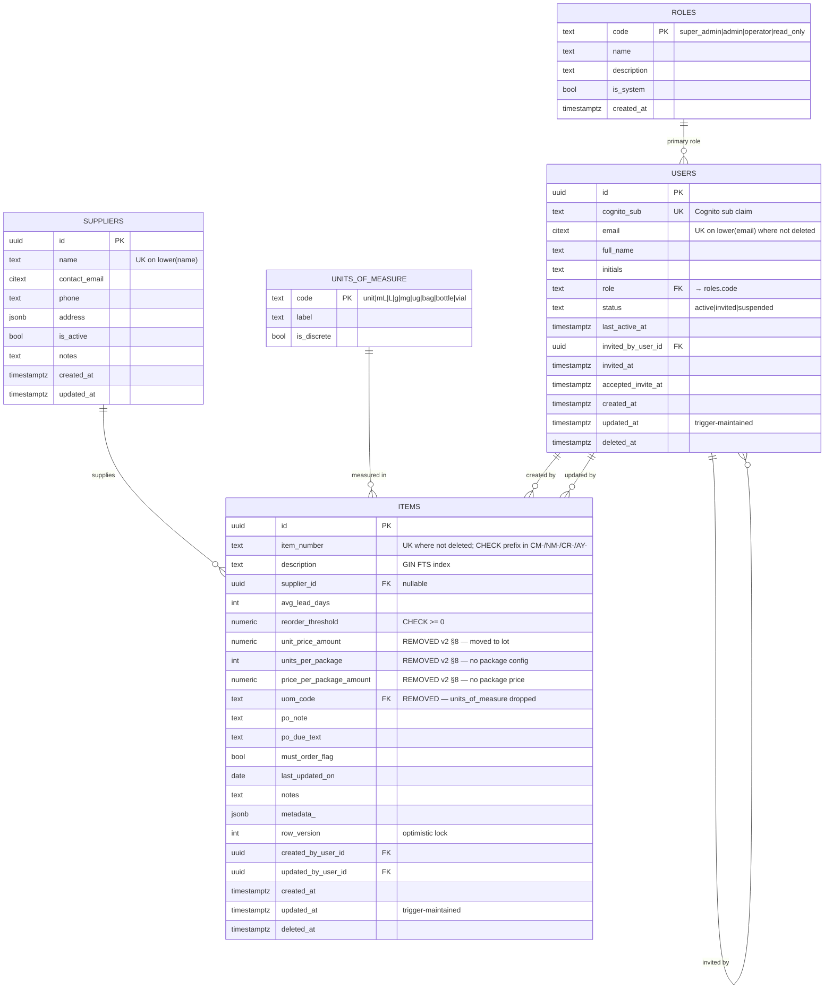

# CellReady IMS — Backend v1 (MVP) Scope

> Delta on top of [backend-data-structure.md](./backend-data-structure.md).
> The full spec is the long-term contract; this doc defines what we actually
> ship first. **Every table dropped from v1 is purely additive in v2 — no
> v1 table changes shape when a deferred module lands.**

---

## 1. v1 goals

- Inventory items (catalogue + master tracker fields from Excel)
- Lots + batches (item × lot × location)
- Ledger (stock in / stock out / adjust) — append-only
- Electronic signatures on movements (21 CFR Part 11)
- Audit log
- Single **super admin** + a handful of users; **no granular permissions
  table yet** — role is a column on `users` for now.

That's it. Anything else listed in the full spec is v2+.

---

## 2. What's in / what's out

### IN (13 tables)

| Schema | Table | Notes |
|--|--|--|
| `meta` | `units_of_measure` | small lookup |
| `meta` | `locations` | `ltree` tree; covers freezers, racks, LN2 positions later |
| `meta` | `suppliers` | seeded from workbook (74 rows) |
| `app` | `settings` | single-row global config |
| `app` | `roles` | lookup with 4 codes (`super_admin`, `admin`, `operator`, `read_only`) |
| `app` | `users` | `role TEXT FK → roles.code` denorm column |
| `app` | `sessions` | hashed-token auth |
| `app` | `items` | master tracker fields, prefix `CHECK` |
| `app` | `lots` | per-item lot + expiration |
| `app` | `item_batches` | `(item × lot × location)` |
| `app` | `ledger_entries` | append-only; DB-enforced |
| `app` | `electronic_signatures` | reason-for-action lives here |
| `audit` | `audit_events` | single table, **not partitioned in v1** |

Plus one **SQL view**:
- `app.v_item_balances` — derives `qty_on_hand`, `last_movement_at`,
  `status_code` from the ledger. In v2 this becomes a real table maintained
  by a trigger (§5.7 below).

### OUT (deferred, purely additive in v2)

| Module | Deferred tables | How v2 adds them |
|--|--|--|
| Full RBAC | `permissions`, `role_permissions`, `user_role_assignments` | New tables only; `users.role` becomes the "default role / fallback"; assignments table layers in overrides. App permission check reads from the new tables when present. |
| Purchase orders | `purchase_orders`, `po_lines` | Optional `ledger_entries.external_ref` already exists to point at an externally-generated PO# in v1; the new tables can backfill from those refs. |
| LN2 storage | `ln2_position_state` | `meta.locations` already supports the tree in v1; only the state overlay is new. |
| Workflow / Kanban | `meta.workflow_stages`, `workflow_cards`, `workflow_transitions` | Fully additive. |
| Forecast | `programs`, `item_program_demand`, `forecast_periods`, `forecast_demand`, `mfg_schedule` | Fully additive. Items keep `description`/`supplier`/`threshold` in v1; per-program columns N–AB stay parked in the workbook until forecast module ships. |
| Notifications | `notification_subscriptions`, `notification_deliveries` | Fully additive. |
| Item balances cache | (table form of) `app.item_balances` | v1 ships as a view of the same name + columns; v2 promotes to a table + trigger. App code reads through a repository so the swap is transparent. |
| Async audit | `app.outbox`, partitioning of `audit_events` | v1 writes audit rows inline. v2 introduces the outbox without changing the `audit_events` schema; partitioning is a separate migration. |
| Activity feed / exports | `audit.activity_feed`, `audit.export_jobs` | Fully additive. |
| Idempotency | `app.idempotency_keys` | Additive; v1 endpoints simply don't enforce, v2 does. |

**Total deferred: 17 tables.** v1 = 13 tables (12 + 1 view).

---

## 3. The permissions bridge (most important part)

The single requirement that drives the v1 shape: **adding granular
permissions later must not require touching any v1 table.**

How v1 handles it:

1. **`app.roles` is a real lookup table** (with `code TEXT PRIMARY KEY`),
   even though there's nothing else to join to yet. Same shape as the full
   spec. Seeded with `super_admin`, `admin`, `operator`, `read_only`.
2. **`app.users.role` is a `TEXT NOT NULL` column with a FK to
   `app.roles(code)`.** This denormalised column is the source of truth for
   authorisation in v1. The app reads it directly.
3. The v1 app has a tiny in-code permission helper:

   ```python
   # app/security/permissions.py
   PERM_MATRIX = {
       "super_admin": {"*": {"*"}},
       # Member management (invite / edit / enable / disable) is
       # super-admin-only, so admin holds users:view and nothing more.
       "admin":      {"inventory": {"view","create","edit","delete","sign"},
                      "users":     {"view"},
                      "audit":     {"view","export"}},
       "operator":   {"inventory": {"view","create","edit","sign"},
                      "audit":     {"view"}},
       "read_only":  {"inventory": {"view"},
                      "audit":     {"view"}},
   }
   def can(user, resource: str, action: str) -> bool:
       role = PERM_MATRIX[user.role]
       return role.get("*") == {"*"} or action in role.get(resource, set())
   ```

4. When v2 adds `permissions`, `role_permissions`, `user_role_assignments`:
   - `PERM_MATRIX` becomes a fallback / seed; the helper switches to a DB
     read.
   - `users.role` stays — it's the "primary role" for display + the default
     when no explicit assignments exist.
   - `user_role_assignments` becomes the override table for users who need
     more than their primary role.
   - **Zero changes** to `users`, `roles`, or any other v1 table.

That's the entire bridge. No prep tables, no commented-out columns, no
`role_id UUID NULL` waiting to be wired up.

---

## 4. v1 ERD

### 4.a Current state — what's actually in the database

This is the live shape as of Alembic head **`e052b2ffa00b`**
(migrations `f0cc0b641382` → `b7c6522aca73` → `e052b2ffa00b`). It's a
proper subset of the planned v1 ERD below; the planned-but-not-built
tables ship with the movements / audit / settings modules.



**Row counts (development DB, snapshot 2026-05-28):**

| Table | Rows | Source |
|--|--|--|
| `app.roles` | 4 | seeded by migration `f0cc0b641382` |
| `app.users` | 1 | lazy-provisioned on first `/auth/me` (bootstrap super admin) |
| `meta.units_of_measure` | 9 | seeded by migration `b7c6522aca73` |
| `meta.suppliers` | 72 | seeded by migration `e052b2ffa00b` from the workbook (73 distinct names; one case-insensitive collision: `BioTechne` / `Biotechne`) |
| `app.items` | 0–N | populated via `POST /v1/items` |

**Deviations from §5 (intentional):**

* `app.users` has `cognito_sub TEXT UNIQUE NOT NULL` and no
  `password_hash` / `mfa_secret` / `mfa_enabled` columns. The doc was
  drafted before Cognito adoption — Cognito holds passwords + MFA, and
  the local row is a mirror keyed by `cognito_sub`. See
  [`project_identity_module`](../memory/) memory + `app/auth/provisioning.py`.
* `app.items.metadata` is named `metadata_` on the wire to avoid a
  collision with SQLAlchemy's reserved `metadata` attribute. DB column
  name is `metadata_` so both ends agree.

### 4.b Planned v1 ERD — what we're building toward

The full v1 shape from §2. The relations below are the eventual graph;
the current state above is a strict subset of this.

```mermaid
erDiagram
    ROLES ||--o{ USERS : "primary role"
    USERS ||--o{ SESSIONS : "has"
    USERS ||--o| SETTINGS : "updated by"

    SUPPLIERS ||--o{ ITEMS : "supplies"
    UNITS_OF_MEASURE ||--o{ ITEMS : "measured in"
    ITEMS ||--o{ LOTS : "produces"
    ITEMS ||--o{ ITEM_BATCHES : "stocked as"
    LOTS ||--o{ ITEM_BATCHES : "grouped by"
    LOCATIONS ||--o{ ITEM_BATCHES : "located at"
    LOCATIONS ||--o{ LOCATIONS : "parent"
    ITEM_BATCHES ||--o{ LEDGER_ENTRIES : "records"
    USERS ||--o{ LEDGER_ENTRIES : "entered by"
    ELECTRONIC_SIGNATURES ||--o| LEDGER_ENTRIES : "signs"
    USERS ||--o{ ELECTRONIC_SIGNATURES : "signed by"

    USERS ||--o{ AUDIT_EVENTS : "actor"
    ELECTRONIC_SIGNATURES ||--o| AUDIT_EVENTS : "signed by"

    SETTINGS {
        bool id PK "always true"
        text org_name
        bool require_signature_on_stock_out
    }
    SESSIONS {
        uuid id PK
        uuid user_id FK
        timestamptz expires_at
        timestamptz revoked_at
    }
    LOCATIONS {
        uuid id PK
        uuid parent_id FK
        ltree path
        text kind
    }
    LOTS {
        uuid id PK
        uuid item_id FK
        text lot_number
        date expires_on
        text status "active|quarantine|expired|consumed|recalled"
    }
    ITEM_BATCHES {
        uuid id PK
        uuid item_id FK
        uuid lot_id FK
        uuid location_id FK
        numeric balance_units
        timestamptz closed_at
    }
    LEDGER_ENTRIES {
        uuid id PK
        uuid batch_id FK
        uuid item_id "denorm"
        text direction "in|out|adjust CHECK"
        numeric qty_in
        numeric qty_out
        numeric balance_after
        date occurred_on
        text initials
        uuid entered_by_user_id FK
        uuid signature_id FK
        text source "app|import|adjustment|system"
        text external_ref "future PO# / mfg run"
    }
    ELECTRONIC_SIGNATURES {
        uuid id PK
        uuid signer_user_id FK
        text intent
        text subject_table "polymorphic"
        uuid subject_id
        text reason
        timestamptz password_verified_at
        text signature_image_url
        text signature_hash
    }
    AUDIT_EVENTS {
        uuid id PK
        timestamptz occurred_at
        uuid actor_user_id FK
        text event_type
        text severity
        text subject_table "polymorphic"
        uuid subject_id
        jsonb diff
        uuid signature_id FK
        text hash "chain per UTC day"
    }
```



**Pending tables, with the migration they'll land in:**

| Table | Lands with module |
|--|--|
| `app.settings` | identity v2 (single-row app config) |
| `app.sessions` | optional — only if per-device revocation lands; Cognito + cookies cover v1 |
| `meta.locations` | LN2 / movements module |
| `app.lots`, `app.item_batches`, `app.ledger_entries` | movements module |
| `app.electronic_signatures` | Part 11 sign-off (alongside ledger) |
| `audit.audit_events` | audit module (gates the first `PATCH` / `DELETE` endpoints) |

Compare to the full ERD: gone are `permissions`, `role_permissions`,
`user_role_assignments`, `programs`, `item_program_demand`,
`item_balances` (now a view), `inventory_statuses` (status derived inline
or via the view), `purchase_orders`, `po_lines`, `ln2_position_state`,
all workflow tables, all forecast tables, all notification tables, the
outbox, idempotency keys, activity feed, export jobs.

---

## 5. v1 table notes

### 5.1 `app.settings`

Identical to spec §5.1. Seed one row.

### 5.2 `app.roles` (v1 form)

```sql
CREATE TABLE app.roles (
  code        TEXT  PRIMARY KEY,
  name        TEXT  NOT NULL,
  description TEXT  NOT NULL,
  is_system   BOOL  NOT NULL DEFAULT TRUE,
  created_at  TIMESTAMPTZ NOT NULL DEFAULT now()
);
INSERT INTO app.roles (code, name, description) VALUES
  ('super_admin','Super Admin','Full access; seeded at deployment, then granted by promotion'),
  ('admin',      'Admin',      'All inventory actions; read-only view of the user directory'),
  ('operator',   'Operator',   'Inventory create/edit/sign'),
  ('read_only',  'Read-Only',  'View only');
```

Note: PK is `code TEXT`, not `id UUID`, because v1 has no other table
joining by UUID anyway. If v2 wants UUIDs we add an `id` column then; the
v1 FK uses `code` either way.

### 5.3 `app.users` (v1 form)

```sql
CREATE TABLE app.users (
  id                 UUID PRIMARY KEY DEFAULT uuid7(),
  email              CITEXT NOT NULL,
  full_name          TEXT NOT NULL,
  initials           TEXT NOT NULL,
  password_hash      TEXT NULL,
  mfa_secret         TEXT NULL,
  mfa_enabled        BOOL NOT NULL DEFAULT FALSE,
  role               TEXT NOT NULL REFERENCES app.roles(code),
  status             TEXT NOT NULL CHECK (status IN ('active','invited','suspended')),
  last_active_at     TIMESTAMPTZ NULL,
  invited_at         TIMESTAMPTZ NULL,
  invited_by_user_id UUID NULL REFERENCES app.users(id),
  accepted_invite_at TIMESTAMPTZ NULL,
  created_at         TIMESTAMPTZ NOT NULL DEFAULT now(),
  updated_at         TIMESTAMPTZ NOT NULL DEFAULT now(),
  deleted_at         TIMESTAMPTZ NULL
);
CREATE UNIQUE INDEX uq_users_email ON app.users (lower(email)) WHERE deleted_at IS NULL;
```

Bootstrap: the seeder inserts a single `super_admin` user from a config
value (`SUPERADMIN_EMAIL`, hashed password). Refuse to start if it doesn't
exist.

### 5.4 `app.items`, `app.lots`, `app.item_batches`

Unchanged from full spec §6.1, §6.3, §6.4. v1 ships these as-is.

### 5.5 `app.ledger_entries`

Unchanged from spec §6.6 **including** `external_ref TEXT NULL`. This is
the hook for v2's `purchase_orders` and manufacturing-run integrations —
v1 doesn't write to it, but it's there so v2 doesn't need an ALTER.

### 5.6 `app.electronic_signatures`

Unchanged from spec §6.7. Polymorphic `(subject_table, subject_id)`
already accommodates `purchase_orders`, `workflow_transitions`,
`export_jobs` when those tables exist — no schema change in v2.

### 5.7 `app.v_item_balances` (view, not table — v1 only)

```sql
CREATE VIEW app.v_item_balances AS
SELECT
  i.id AS item_id,
  COALESCE(SUM(l.qty_in)  - SUM(l.qty_out), 0) AS qty_on_hand,
  0::numeric(14,3) AS qty_on_order,                        -- placeholder; populated by PO module in v2
  COALESCE(SUM(l.qty_in)  - SUM(l.qty_out), 0)
    * COALESCE(i.unit_price_amount, 0)                     AS inv_value_amount,
  0::numeric(14,2) AS po_value_amount,                     -- placeholder
  CASE
    WHEN COALESCE(SUM(l.qty_in) - SUM(l.qty_out), 0) <= 0 THEN 'out_of_stock'
    WHEN COALESCE(SUM(l.qty_in) - SUM(l.qty_out), 0) <= i.reorder_threshold THEN 'low_stock'
    ELSE 'available'
  END AS status_code,
  MAX(l.occurred_at) AS last_movement_at
FROM app.items i
LEFT JOIN app.ledger_entries l ON l.item_id = i.id
WHERE i.deleted_at IS NULL
GROUP BY i.id, i.unit_price_amount, i.reorder_threshold;
```

The view exposes **the same columns** as the full-spec table. When v2
promotes it to a real table:
1. Drop the view.
2. Create the table with identical columns.
3. Add a trigger on `ledger_entries` to keep it current.
4. Backfill once from the same query.
**App code doesn't change** — it always reads `app.v_item_balances` or
`app.item_balances` through a repository that doesn't care which it is.
Use a synonym (Postgres doesn't have synonyms; either rename the view to
`app.item_balances` from the start, or have the repository select from
both with a feature flag). Recommended: name the view
`app.item_balances` directly — Postgres allows a view of that name and v2
swaps it for the table without any app rename.

### 5.8 `audit.audit_events` (v1 form)

Same schema as spec §10.1 **but not partitioned**:

```sql
CREATE TABLE audit.audit_events (
  id            UUID PRIMARY KEY DEFAULT uuid7(),
  occurred_at   TIMESTAMPTZ NOT NULL,
  actor_user_id UUID NULL,
  actor_kind    TEXT NOT NULL CHECK (actor_kind IN ('user','system','integration')),
  event_type    TEXT NOT NULL,
  severity      TEXT NOT NULL CHECK (severity IN ('info','warning','danger')),
  subject_table TEXT NOT NULL,
  subject_id    UUID NULL,
  subject_label TEXT NULL,
  action        TEXT NOT NULL,
  before_state  JSONB NULL,
  after_state   JSONB NULL,
  diff          JSONB NULL,
  context       JSONB NOT NULL DEFAULT '{}'::jsonb,
  signature_id  UUID NULL,
  prev_hash     TEXT NULL,
  hash          TEXT NOT NULL
);
CREATE INDEX ix_audit_events_occurred_at  ON audit.audit_events (occurred_at DESC);
CREATE INDEX ix_audit_events_subject      ON audit.audit_events (subject_table, subject_id, occurred_at DESC);
CREATE INDEX ix_audit_events_actor        ON audit.audit_events (actor_user_id, occurred_at DESC);
```

Permissions are still enforced:

```sql
REVOKE UPDATE, DELETE ON audit.audit_events FROM app_rw_role;
```

When v2 partitions:
- Rename table to `audit.audit_events_legacy`.
- Create partitioned `audit.audit_events` with same columns + `PRIMARY KEY (id, occurred_at)`.
- Move data with a one-off backfill.
- Drop the legacy table.

The hash chain (§10.1 of the spec, scoped per UTC day) keeps working
across the swap because the hashes are content-derived, not row-id based.

### 5.9 Write path in v1 — synchronous, no outbox

V1 writes audit rows inline in the same transaction as the operational
write:

```python
async def record_movement(...):
    async with db.transaction():
        sig    = await sign(...)
        entry  = await insert_ledger(...)
        await record_audit(event_type="inventory.movement.signed",
                           subject_table="ledger_entries",
                           subject_id=entry.id,
                           signature_id=sig.id, ...)
```

`record_audit()` is the seam. In v2 it becomes
`INSERT INTO app.outbox` + a worker. Endpoints don't change.

---

## 6. Forward-compatibility checklist

Things we do **now** specifically so v2 isn't a breaking change:

| Decision | Why |
|--|--|
| `users.role TEXT FK → roles.code` (not `role_id UUID`) | Adding RBAC in v2 doesn't require migrating `users` |
| `roles.code` PK (not `id UUID`) | One join key, consistent across v1/v2 |
| `app.item_balances` as a **view** with the v2 column shape | Promotion to table is invisible to the app |
| `electronic_signatures(subject_table, subject_id)` polymorphic from day 1 | Accepts new subject tables in v2 with no schema change |
| `audit_events(subject_table, subject_id)` polymorphic from day 1 | Same |
| `audit_events.event_type` namespaced (e.g. `inventory.movement.signed`) | New modules just add new namespaces |
| `ledger_entries.external_ref` already present | Lets v1 reference an externally-managed PO# without a PO module |
| `audit_events` hash + prev_hash columns present from v1 | Daily integrity check works the same when v2 partitions arrive |
| `record_audit()` helper, not inline `INSERT` | Trivial swap to outbox in v2 |
| `app.settings.require_signature_on_stock_out` already a column | v1 can flip it on/off; v2 doesn't need a new toggle |

---

## 7. v1 seeder & migration steps

Same approach as full spec §14, but trimmed:

1. **Alembic init** — create `app`, `meta`, `audit` schemas. **Skip `archive`.**
2. **Migration 0001** — reference tables: `meta.units_of_measure`,
   `meta.locations`, `meta.suppliers`, `app.roles`, `app.settings`.
3. **Migration 0002** — `app.users`, `app.sessions`.
4. **Migration 0003** — `app.items`, `app.lots`, `app.item_batches`,
   `app.ledger_entries`, `app.electronic_signatures`. Triggers:
   `tg_ledger_update_batch_balance` (still needed — batches keep
   `balance_units`), `tg_items_check_pkg_price`,
   `tg_ledger_no_future_date`.
5. **Migration 0004** — `audit.audit_events`. Trigger
   `tg_audit_events_chain`. `REVOKE UPDATE, DELETE`.
6. **Migration 0005** — view `app.item_balances`.
7. **Seeder** —
   - Roles (4 rows from §5.2 above).
   - One `super_admin` user from env.
   - Suppliers from `Demo Inventory Control.xlsx` (74 rows).
   - Items + lots + batches + ledger entries via the existing
     `scripts/sync-from-xlsx.py` logic, ported into `app/seed.py`.
   - One `audit_events` row for the import (`inventory.import.completed`).

---

## 8. Out-of-scope v1 endpoints

For clarity on what FastAPI exposes in v1:

**IN:**
- `POST /auth/login`, `POST /auth/logout`, `GET /auth/me`
- `GET /items`, `GET /items/{id}`, `POST /items`, `PATCH /items/{id}`,
  `DELETE /items/{id}` (soft delete; super_admin only)
- `GET /items/{id}/ledger`
- `POST /movements` — stock in/out/adjust, requires e-sign
- `GET /audit/events` (filters: subject, actor, date range, event_type)
- `GET /users`, `POST /users`, `PATCH /users/{id}` (super_admin only)
- `GET /settings`, `PATCH /settings`

**OUT (v2+):**
- `/permissions`, `/role-assignments`
- `/purchase-orders`
- `/kanban/*`
- `/ln2/positions`
- `/forecast/*`
- `/notifications/*`
- `/exports/*`

---

## 9. What we accept by skipping things

Being honest about the trade-offs:

- **Performance at scale.** A view-based `item_balances` is fine for
  ~300 items × low movement; will need promotion to a table once we hit
  ~100k ledger entries.
- **Audit ingestion latency.** Inline audit writes add ~1ms per
  transaction. Fine for v1 single-org load; outbox arrives before that
  becomes noticeable.
- **Permission overrides.** A user can't have a hand-edited permission
  set in v1 — they get exactly what their role gives them. The four
  preset roles cover the demo scenarios fully.
- **No idempotency in v1.** A double-clicked "record movement" will
  generate two ledger entries. Acceptable for a controlled MVP; add
  `idempotency_keys` before public exposure.

---

*End of MVP scope doc.* Greenlight this and I'll generate the four
Alembic migrations + SQLAlchemy models for the 13 tables + view.
