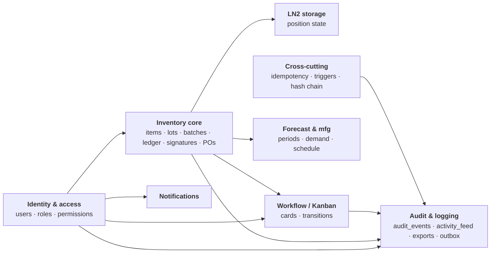
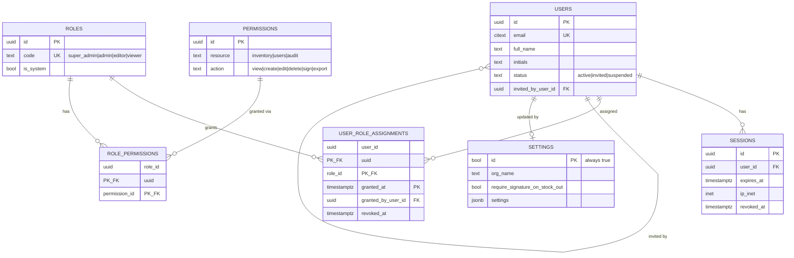

# CellReady IMS — ERD & Table Inventory

> Companion to [backend-data-structure.md](./backend-data-structure.md). The
> structure doc is the contract; this doc is the picture. If they disagree,
> the structure doc wins.
>
> Diagrams are Mermaid (`erDiagram` + `flowchart`). Render in GitHub,
> VS Code (Markdown Preview Mermaid Support), or any Mermaid live editor.

---

## 1. Schemas

| Schema | Purpose |
|--|--|
| `meta` | Reference data (slowly changing lookups) |
| `app` | Operational tables (user-facing state) |
| `audit` | Immutable log; partitioned by month |
| `archive` | Detached cold partitions (no app reads) |

---

## 2. Table inventory by module

### Module 1 — Identity & access (§5)

| Table | PK | Key FKs |
|--|--|--|
| `app.settings` | `id BOOL` (single-row) | `updated_by_user_id → app.users` |
| `app.users` | `id` | self: `invited_by_user_id` |
| `app.roles` | `id` | — |
| `app.permissions` | `id` | UQ `(resource, action)` |
| `app.role_permissions` | `(role_id, permission_id)` | `→ roles`, `→ permissions` |
| `app.user_role_assignments` | `(user_id, role_id, granted_at)` | `→ users`, `→ roles`; `granted_by_user_id → users` |
| `app.sessions` | `id` | `user_id → users` |

### Module 2 — Inventory core (§4 + §6)

| Table | PK | Key FKs |
|--|--|--|
| `meta.inventory_statuses` | `code` | — |
| ~~`meta.units_of_measure`~~ | — | **REMOVED (v2 §8 · migration `b7c8d9e0f1a2`)** — UOM dropped |
| `meta.locations` | `id` | self: `parent_id` |
| `meta.suppliers` | `id` | — |
| `meta.programs` | `id` | — |
| `app.items` | `id` | `supplier_id → suppliers`, `created_by_user_id`, `updated_by_user_id` (`uom_code → units_of_measure` REMOVED, v2 §8) |
| `app.item_program_demand` | `(item_id, program_id)` | `→ items`, `→ programs` |
| `app.lots` | `id` | `item_id → items` |
| `app.item_batches` | `id` | `item_id → items`, `lot_id → lots`, `location_id → locations` |
| `app.item_balances` | `item_id` | `→ items`, `status_code → inventory_statuses` |
| `app.ledger_entries` | `id` | `batch_id → item_batches`; denorm: `item_id`, `lot_id`, `location_id`; `entered_by_user_id → users`, `signature_id → electronic_signatures` |
| `app.electronic_signatures` | `id` | `signer_user_id → users`; polymorphic `(subject_table, subject_id)` — no FK |
| `app.purchase_orders` | `id` | `supplier_id → suppliers`, `approval_signature_id → electronic_signatures` |
| `app.po_lines` | `id` | `po_id → purchase_orders`, `item_id → items`, `lot_received_id → lots` |

### Module 3 — Storage / LN2 (§7)

| Table | PK | Key FKs |
|--|--|--|
| `app.ln2_position_state` | `location_id` | `→ locations`, `current_batch_id → item_batches`, `updated_by_user_id → users` |

### Module 4 — Workflow / Kanban (§8)

| Table | PK | Key FKs |
|--|--|--|
| `meta.workflow_stages` | `id` | — |
| `app.workflow_cards` | `id` | `item_id → items`, `stage_id → workflow_stages`, `assignee_user_id → users`, `linked_po_id → purchase_orders` |
| `app.workflow_transitions` | `id` | `card_id → workflow_cards`, `from_stage_id` + `to_stage_id → workflow_stages`, `transitioned_by_user_id → users`, `signature_id → electronic_signatures` |

### Module 5 — Forecast & mfg (§9)

| Table | PK | Key FKs |
|--|--|--|
| `app.forecast_periods` | `id` | — |
| `app.forecast_demand` | `(item_id, program_id, period_id)` | `→ items`, `→ programs`, `→ forecast_periods` |
| `app.mfg_schedule` | `id` | `program_id → programs` |

### Module 6 — Audit & logging (§10)

| Table | PK | Key FKs |
|--|--|--|
| `audit.audit_events` | `(id, occurred_at)` partitioned | `actor_user_id → users`, `signature_id → electronic_signatures`; polymorphic `(subject_table, subject_id)` |
| `audit.activity_feed` | `(id, occurred_at)` partitioned | `user_id → users` |
| `audit.export_jobs` | `id` | `requested_by_user_id → users`, `signature_id → electronic_signatures` |
| `app.outbox` | `id` | — (delivery buffer) |

### Module 7 — Notifications (§11)

| Table | PK | Key FKs |
|--|--|--|
| `app.notification_subscriptions` | `id` | `user_id → users` |
| `app.notification_deliveries` | `id` | `subscription_id → notification_subscriptions` |

### Module 8 — Cross-cutting (§12)

| Table | PK | Key FKs |
|--|--|--|
| `app.idempotency_keys` | `key` | `user_id → users` |

---

## 3. Module-level overview



---

## 4. ERD — Module A: Identity & access



---

## 5. ERD — Module B: Inventory core

```mermaid
erDiagram
    SUPPLIERS ||--o{ ITEMS : "supplies"
    UNITS_OF_MEASURE ||--o{ ITEMS : "measured in"
    ITEMS ||--o{ LOTS : "produces"
    ITEMS ||--o{ ITEM_BATCHES : "stocked as"
    LOTS ||--o{ ITEM_BATCHES : "grouped by"
    LOCATIONS ||--o{ ITEM_BATCHES : "located at"
    ITEM_BATCHES ||--o{ LEDGER_ENTRIES : "records"
    ITEMS ||--|| ITEM_BALANCES : "snapshot"
    INVENTORY_STATUSES ||--o{ ITEM_BALANCES : "labels"
    ITEMS ||--o{ ITEM_PROGRAM_DEMAND : "demand per item"
    PROGRAMS ||--o{ ITEM_PROGRAM_DEMAND : "demand per program"
    USERS ||--o{ LEDGER_ENTRIES : "entered by"
    ELECTRONIC_SIGNATURES ||--o| LEDGER_ENTRIES : "signs"
    USERS ||--o{ ELECTRONIC_SIGNATURES : "signed by"
    SUPPLIERS ||--o{ PURCHASE_ORDERS : "ordered from"
    PURCHASE_ORDERS ||--o{ PO_LINES : "contains"
    ITEMS ||--o{ PO_LINES : "ordered"
    LOTS ||--o{ PO_LINES : "received as"
    ELECTRONIC_SIGNATURES ||--o| PURCHASE_ORDERS : "approves"
    LOCATIONS ||--o{ LOCATIONS : "parent"

    %% Pricing/UOM columns (unit_price_amount, units_per_package,
    %% price_per_package_amount, uom_code) REMOVED per v2 §8 — track unit
    %% price only, no package-configuration price. Unit price now lives on
    %% LOTS.unit_price_amount (migration b7c8d9e0f1a2).
    ITEMS {
        uuid id PK
        text item_number UK
        text description
        uuid supplier_id FK
        int avg_lead_days
        numeric reorder_threshold "col M"
        date last_updated_on "col AF"
        int row_version
        timestamptz deleted_at
    }
    LOTS {
        uuid id PK
        uuid item_id FK
        text lot_number "UQ item_id+lot_number"
        date expires_on
        text status "active|quarantine|expired|consumed|recalled"
    }
    ITEM_BATCHES {
        uuid id PK
        uuid item_id FK
        uuid lot_id FK
        uuid location_id FK
        numeric balance_units
        timestamptz opened_at
        timestamptz closed_at
    }
    LEDGER_ENTRIES {
        uuid id PK
        uuid batch_id FK
        uuid item_id "denorm"
        uuid lot_id "denorm"
        uuid location_id "denorm"
        text direction "in|out|adjust CHECK"
        numeric qty_in
        numeric qty_out
        numeric balance_after
        date occurred_on
        timestamptz occurred_at
        text initials
        uuid entered_by_user_id FK
        uuid signature_id FK
        text source "app|import|adjustment|system"
    }
    ELECTRONIC_SIGNATURES {
        uuid id PK
        uuid signer_user_id FK
        timestamptz signed_at
        text intent
        text subject_table "polymorphic"
        uuid subject_id "polymorphic"
        text reason "21 CFR Part 11 §11.50"
        timestamptz password_verified_at
        text signature_image_url
        text signature_hash
    }
    ITEM_BALANCES {
        uuid item_id PK_FK
        numeric qty_on_hand
        numeric qty_on_order
        numeric inv_value_amount
        numeric po_value_amount
        text status_code FK "→ inventory_statuses"
        timestamptz last_movement_at
    }
    ITEM_PROGRAM_DEMAND {
        uuid item_id PK_FK
        uuid program_id PK_FK
        numeric units
        numeric ext_units
        numeric ext_value_amount
    }
    PURCHASE_ORDERS {
        uuid id PK
        uuid supplier_id FK
        text po_number UK
        text status "draft|sent|partial|received|closed|cancelled"
        timestamptz ordered_at
        timestamptz expected_at
        numeric total_amount
        uuid approval_signature_id FK
    }
    PO_LINES {
        uuid id PK
        uuid po_id FK
        uuid item_id FK
        numeric qty_ordered
        numeric qty_received
        numeric unit_price_amount
        uuid lot_received_id FK
    }
    SUPPLIERS {
        uuid id PK
        text name UK
        text contact_email
    }
    UNITS_OF_MEASURE {
        text code PK
        text label
        bool is_discrete
    }
    LOCATIONS {
        uuid id PK
        uuid parent_id FK
        ltree path
        text kind "site|room|freezer|shelf|ln2_*"
    }
    PROGRAMS {
        uuid id PK
        text code UK "IDP-023|G-CART|NEW-SKU-*"
    }
    INVENTORY_STATUSES {
        text code PK "available|low_stock|out_of_stock"
        text label
        text tone
    }
```

---

## 6. ERD — Module C: LN2 storage + Workflow

```mermaid
erDiagram
    LOCATIONS ||--o| LN2_POSITION_STATE : "current state"
    ITEM_BATCHES ||--o{ LN2_POSITION_STATE : "currently holds"
    USERS ||--o{ LN2_POSITION_STATE : "updated by"

    ITEMS ||--o{ WORKFLOW_CARDS : "card for"
    WORKFLOW_STAGES ||--o{ WORKFLOW_CARDS : "current stage"
    USERS ||--o{ WORKFLOW_CARDS : "assigned to"
    PURCHASE_ORDERS ||--o| WORKFLOW_CARDS : "linked PO"
    WORKFLOW_CARDS ||--o{ WORKFLOW_TRANSITIONS : "transitions"
    WORKFLOW_STAGES ||--o{ WORKFLOW_TRANSITIONS : "from/to stage"
    USERS ||--o{ WORKFLOW_TRANSITIONS : "transitioned by"
    ELECTRONIC_SIGNATURES ||--o| WORKFLOW_TRANSITIONS : "signs"

    LN2_POSITION_STATE {
        uuid location_id PK_FK
        text status "empty|occupied|reserved|quarantine"
        uuid current_batch_id FK
        timestamptz since
        uuid updated_by_user_id FK
        int row_version
    }
    WORKFLOW_CARDS {
        uuid id PK
        uuid item_id FK
        uuid stage_id FK
        text priority "critical|high|medium|low"
        timestamptz opened_at
        timestamptz closed_at
        text opened_reason
        uuid assignee_user_id FK
        uuid linked_po_id FK
    }
    WORKFLOW_TRANSITIONS {
        uuid id PK
        uuid card_id FK
        uuid from_stage_id FK
        uuid to_stage_id FK
        uuid transitioned_by_user_id FK
        uuid signature_id FK
        text comment
        timestamptz transitioned_at
    }
    WORKFLOW_STAGES {
        uuid id PK
        text code UK "low_stock|review|pending|ordered|received|closed"
        text label
        bool is_terminal
        int sort_order
    }
```

---

## 7. ERD — Module D: Audit, Forecast, Notifications, Cross-cutting

```mermaid
erDiagram
    USERS ||--o{ AUDIT_EVENTS : "actor"
    ELECTRONIC_SIGNATURES ||--o| AUDIT_EVENTS : "signed by"
    USERS ||--o{ ACTIVITY_FEED : "actor"
    USERS ||--o{ EXPORT_JOBS : "requested by"
    ELECTRONIC_SIGNATURES ||--o| EXPORT_JOBS : "signs"

    ITEMS ||--o{ FORECAST_DEMAND : "demand"
    PROGRAMS ||--o{ FORECAST_DEMAND : "program"
    FORECAST_PERIODS ||--o{ FORECAST_DEMAND : "period"
    PROGRAMS ||--o{ MFG_SCHEDULE : "schedule"

    USERS ||--o{ NOTIFICATION_SUBSCRIPTIONS : "subscribes"
    NOTIFICATION_SUBSCRIPTIONS ||--o{ NOTIFICATION_DELIVERIES : "delivers"
    USERS ||--o{ IDEMPOTENCY_KEYS : "issued by"

    AUDIT_EVENTS {
        uuid id PK
        timestamptz occurred_at PK "partition key"
        uuid actor_user_id FK
        text actor_kind "user|system|integration"
        text event_type "domain.entity.action"
        text severity "info|warning|danger"
        text subject_table "polymorphic"
        uuid subject_id "polymorphic"
        text action
        jsonb before_state
        jsonb after_state
        jsonb diff
        jsonb context
        uuid signature_id FK
        text prev_hash
        text hash "chain per UTC day"
    }
    ACTIVITY_FEED {
        uuid id PK
        timestamptz occurred_at PK "partition key"
        uuid user_id FK
        text kind "item.viewed|search.performed|..."
        uuid subject_id
        jsonb metadata
    }
    EXPORT_JOBS {
        uuid id PK
        uuid requested_by_user_id FK
        timestamptz requested_at
        jsonb filter
        text format "csv|pdf|jsonl"
        bigint row_count
        uuid signature_id FK
        text file_url
    }
    OUTBOX {
        uuid id PK
        jsonb payload
        int attempts
        text last_error
        timestamptz processed_at
    }
    FORECAST_PERIODS {
        uuid id PK
        text code UK "FY24Q2|FY24Q3|..."
        date period_start
        date period_end
        bool is_active
    }
    FORECAST_DEMAND {
        uuid item_id PK_FK
        uuid program_id PK_FK
        uuid period_id PK_FK
        numeric units
    }
    MFG_SCHEDULE {
        uuid id PK
        uuid program_id FK
        date month
        numeric units
    }
    NOTIFICATION_SUBSCRIPTIONS {
        uuid id PK
        uuid user_id FK
        text kind "expiry_warning|low_stock|..."
        text channel "in_app|email"
        bool is_active
    }
    NOTIFICATION_DELIVERIES {
        uuid id PK
        uuid subscription_id FK
        text notification_kind
        uuid subject_id
        timestamptz read_at
        timestamptz dismissed_at
        jsonb body
    }
    IDEMPOTENCY_KEYS {
        text key PK
        uuid user_id FK
        text endpoint
        text request_hash
        int response_status
        jsonb response_body
        timestamptz expires_at
    }
```

---

## 8. Things the ERDs do *not* show

Worth flagging because they affect review:

1. **Polymorphic links.** `app.electronic_signatures(subject_table, subject_id)` and `audit.audit_events(subject_table, subject_id)` point at any of `items`, `lots`, `purchase_orders`, `workflow_cards`, `users`, etc. Mermaid can't draw "FK to N possible tables", so it's annotated as `"polymorphic"` on the column. The app enforces validity; no DB FK.
2. **Denormalised FKs on `ledger_entries`.** `(item_id, lot_id, location_id)` are duplicated from `item_batches` for query speed. Real referential integrity is via `batch_id`. Triggers keep the denorm in sync.
3. **Partitioning.** `audit.audit_events` and `audit.activity_feed` are partitioned by month/week on `occurred_at`. The diagrams show only the logical table; physical partitions live in the `audit` schema (hot) or `archive` schema (cold).
4. **Per-table triggers** (`tg_ledger_update_batch_balance`, `tg_audit_events_chain`, …) — see structure doc §13. (`tg_items_check_pkg_price` REMOVED — no package-price invariant, v2 §8.)
5. **`row_version` columns.** Shown only on `items` and `ln2_position_state` for brevity; the rule (§1 #8) applies to every mutable operational row.

---

## 9. Cardinality summary (quick reference)

| Relationship | Cardinality | Note |
|--|--|--|
| `users` ↔ `roles` | many-to-many via `user_role_assignments` | append-only with `revoked_at` |
| `items` ↔ `lots` | one-to-many | unique `(item_id, lot_number)` |
| `items` × `lots` × `locations` ↔ `item_batches` | one open batch per triple | partial unique index `WHERE closed_at IS NULL` |
| `item_batches` ↔ `ledger_entries` | one-to-many | append-only |
| `items` ↔ `item_balances` | one-to-one | denorm; trigger-maintained |
| `items` ↔ `purchase_orders` | many-to-many via `po_lines` | |
| `items` ↔ `workflow_cards` | one-to-many | item can have many cards over time |
| `workflow_cards` ↔ `workflow_transitions` | one-to-many | append-only |
| `locations` ↔ `locations` | tree (ltree path) | `kind` discriminates `site / freezer / ln2_position / …` |
| `users` ↔ `audit_events` | one-to-many | `actor_user_id` nullable for system actors |

---

*End of ERD doc.*
