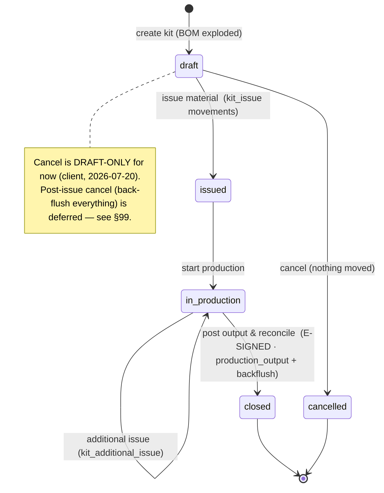
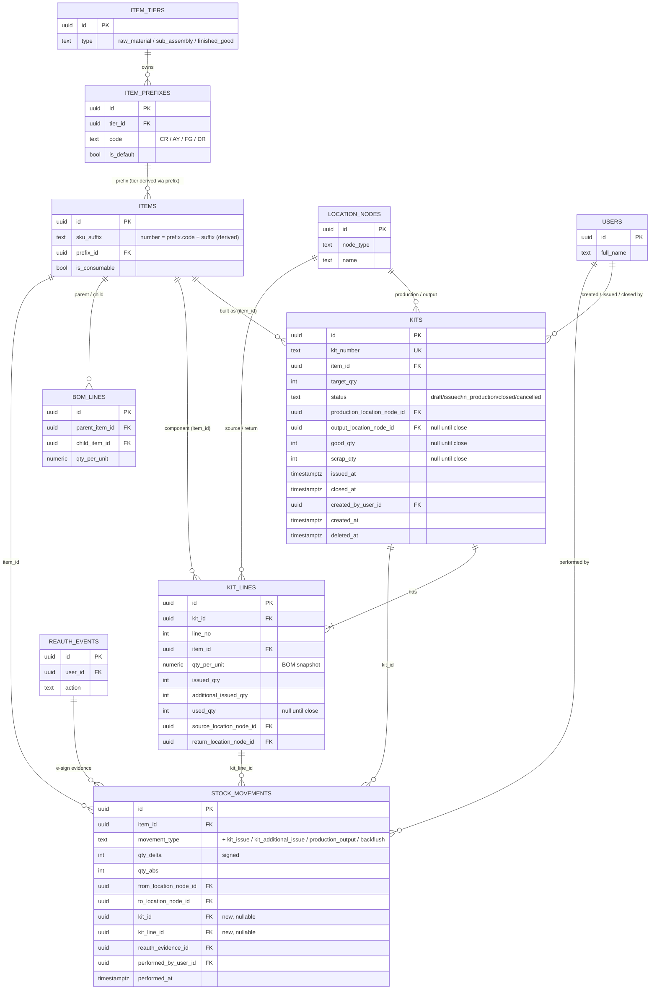

# Kitting, Back-Flush & Reconciliation — Backend Table Brief

> **Route:** `/reconciliation` (page title **"Kitting & Reconciliation"**) · **Frontend entry:** `frontend/src/components/reconciliation/*` (currently a frontend-only mock; store `reconciliation-store.ts`, pure rules `reconciliation-engine.ts`).
> **Status:** `built 2026-07-21` — `kitting01`, `kitting02`, **`kitting03`** applied on dev; API + UI live. The §0.3a correction is **implemented**: issue now moves material to the production node, excess can be returned mid-production (TRX-008), and post-issue cancel returns everything. Delivery detail + test results: [`kitting-wip-build.md`](kitting-wip-build.md).
> **Spec sources:** `CellReady_Transaction_Spec_2026-07-01` §1–§4 · `CellReady_SRS_2026-07-01` §3–§4 · SRS Amendment 3 (2026-07-09) §8 · Amendment 4 (2026-07-15) §8 (SEQ-002 puts kitting + back-flush in this build slot).

This brief proposes the tables for the kit lifecycle **Draft → Issued → In Production → Closed** (plus **Cancelled**), the back-flush of unused material, and the yield/scrap capture at close-out. It reuses the existing append-only `app.stock_movements` ledger for every quantity change rather than inventing a parallel stock table — on-hand stays derived through `app.v_item_stock`.

---

## 0. Decisions driving this work (user-confirmed on the frontend mock, 2026-07-17)

These are already settled in the mock and carry into the backend unless flagged in §99.

1. **Three tiers, prefix-agnostic.** A kit builds a **sub-assembly (AY)** or a **finished good (FG)**; its BOM lines are **raw materials (CR)** and/or nested AYs. Eligibility comes from `item_tiers.type`, never the ID prefix.
2. **Consumables are never in a BOM** (Transaction Spec §4.3). Therefore a **kit line is never a consumable** — no consumable columns on kit tables. Consumable Kanban reconciliation is a *separate* future feature (§99).
3. **Kitted material stops counting as available on-hand at issue time** (REQ-2026-07-09-TRX-001) **and physically moves to the production location** (`Transaction_Spec` §2). Issue is a stock-**out** of the *available* balance and a **relocation** of the material to the production node. See §0.3a.

4. **Material is never bound to a production lot at kitting time** (REQ-2026-07-09-TRX-002) — which is exactly why a cancelled kit can always hand its material back with nothing stranded.
5. **Returns post as an explicit back-flush**, never a plain receipt (REQ-2026-07-09-TRX-003) → a distinct `backflush` movement type so the ledger self-explains (*issued 15, used 12, backflushed 3*).
6. **Reconciliation happens at transact-into-inventory, not at shipment** (REQ-2026-07-01-BFL-002) — the production output and the back-flush commit together, in one transaction, at close-out.
7. **Over-use is blocked, not absorbed.** `used_qty` may not exceed `issued_qty + additional_issued_qty`; the operator records an explicit additional issue instead (keeps the ledger honest, REQ-2026-07-09-TRX-003). Enforced by a DB CHECK.
8. **Scrap/yield captured at close-out** (REQ-2026-07-01-BFL-004): `good_qty` (good units) + `scrap_qty`; yield derived.
9. **FG → customer shipment is out of scope here** — a separate terminal transaction (TRX-005/006), its own screen.

### 0.3a Correction — the production location holds the WIP (2026-07-21)

**The original §0.3 was wrong, and the shipped build follows the wrong version.** It read "the production location is advisory, not a stock-holding node", attributed to *client 2026-07-20*. **That attribution was incorrect — no client document says it.** It originated in an in-session choice framed on a misreading of TRX-001, and it **contradicts the Transaction Spec**.

**Source of truth — `CellReady_Transaction_Spec_2026-07-01` §2 "Kitting for Inventory (AY or FG)"**, the note under *Table 1 — Kit Structure*:

> "Note: **Location must be updated from the storage location an item was originally assigned to the production or manufacturing location it is moved to for kitting.**"

**REQ-2026-07-09-TRX-001 does not conflict with it** — that was the misread:

> "Kitted product items shall be visible as consumed **from source inventory** at issue time: if fifty are on hand and twenty-five are **kitted to manufacturing**, the system shall report twenty-five on hand."

"Consumed *from source*" ≠ "ceases to exist". Available on-hand falls 50 → 25 because the other 25 is **WIP at the production location**, and "kitted **to** manufacturing" names the destination outright. One model satisfies both requirements:

> **Issue moves the material source → production node; the production node is excluded from the available balance.**

This keeps `v_item_stock` meaning *available* stock — so the on-hand arithmetic in §4.3/§5 is **unchanged** — while making "what is physically on the floor right now?" answerable from `lot_allocations`, which today it is not.

---

## 1. Scope

**This module owns:**

- `app.kits` — the kit header (what is being built, where, in what state).
- `app.kit_lines` — the per-component reconciliation grid (needed / issued / additional / used / return location).
- **Additions to `app.stock_movements`**: four new `movement_type` values (`kit_issue`, `kit_additional_issue`, `production_output`, `backflush`) and two nullable trace FKs (`kit_id`, `kit_line_id`).

**This module deliberately does NOT own:**

- **On-hand quantity** — stays derived from the ledger via `app.v_item_stock` (no new stock table). Issue/output/backflush are just signed `qty_delta` rows.
- **Per-location placement of finished output** — that is the Location System's job (`app.lot_allocations`, `meta.location_nodes`). This module records the *movement* into the output node; placement into a specific Box cell, if needed, is a downstream Location System action.
- **BOM authoring** — `app.bom_lines` already exists; a kit *snapshots* it, it does not edit it.
- **Consumable Kanban counts, planning, and customer shipment** — see §99 / cross-module.

---

## 2. Spec / frontend-mock → table mapping

| Frontend mock (`reconciliation-data.ts`) | Backend |
|--|--|
| `Kit` (id, parentItemId, buildQty, status, productionLocation, createdAt/By, issuedAt, closedAt, qtyMade, qtyScrapped, outputLocation) | `app.kits` row |
| `KitLine` (itemId, qtyPerUnit, qtyNeeded, qtyIssued, qtyAdditional, qtyUsed, sourceLocation, returnLocation) | `app.kit_lines` row (`qtyNeeded`, `qtyReturned` **derived**) |
| `KitEvent` ledger (`issue`, `additional_issue`, `production_output`, `backflush`) | `app.stock_movements` rows (`kit_id`/`kit_line_id` set) |
| `KitEvent` `consume` / `scrap` (qtyDelta 0) | **not movements** — `kit_lines.used_qty` / `kits.scrap_qty`; optional `audit.audit_events` rows |
| `StockMap` overlay | derived: item total via `v_item_stock`, per-node via movement from/to nodes |
| Consumables reconciliation tab (removed from UI) | out of scope (§99) |

---

## 3. Reference data / enums

**Kit status is a native PG enum `app.kit_status`** (client 2026-07-20) — a deliberate exception to the house TEXT+CHECK convention. The migration owns the type (`CREATE TYPE`); the model references it with `ENUM(..., create_type=False)`, same pattern as `app.invite_status`. Movement types stay TEXT+CHECK (matches `MOVEMENT_TYPES` / `LOT_STATUSES` / `NODE_TYPES`).

```python
# app/models/kitting.py — native enum for status
KIT_STATUSES = ("draft", "issued", "in_production", "closed", "cancelled")
kit_status_enum = ENUM(*KIT_STATUSES, name="kit_status", schema="app", create_type=False)

# app/models/inventory.py — movement types stay TEXT+CHECK; the four kit types
# are appended to the existing tuple:
MOVEMENT_TYPES = (
    "receipt", "dispense", "adjustment", "discard", "transfer_out", "transfer_in",
    "kit_issue", "kit_additional_issue", "production_output", "backflush",
)
```

Kit-status lifecycle:



> **Note:** the mock collapses `issued → in_production` automatically on issue. The backend keeps them distinct so "material issued but build not started" is representable; the API may still advance both in one call.

---

## 4. Core tables

### 4.1 `app.kits`

| Column | Type | Notes |
|--|--|--|
| `id` | `UUID PK DEFAULT gen_random_uuid()` | |
| `kit_number` | `TEXT NOT NULL` | human id `KIT-0001`, from `app.kit_number_seq`; partial-unique where `deleted_at IS NULL` (`uq_kits_kit_number`) |
| `item_id` | `UUID NOT NULL FK → app.items(id)` `RESTRICT` | the AY/FG being built (table-qualify vs `kit_lines.item_id`, which is a component); API validates its tier is built + has a BOM. **Tier is derived `item → item_prefixes → item_tiers` (`items.tier_id` was dropped 2026-07-20); eligibility still reads `item_tiers.type`.** |
| `target_qty` | `INTEGER NOT NULL` | `ck_kits_target_qty_positive` (`> 0`) |
| `status` | `app.kit_status NOT NULL DEFAULT 'draft'` | native PG enum (client 2026-07-20); values = `KIT_STATUSES` |
| `production_location_node_id` | `UUID NOT NULL FK → meta.location_nodes(id)` `RESTRICT` | **must reference a real seeded node** (client, 2026-07-20) — no free-text. Clean Room 1/2, Manufacturing Floor, PD Lab One/Two seeded as `flat` nodes (new `flat_category = 'production'`). **Holds the WIP** (§0.3a, `Transaction_Spec` §2): issued components are *relocated here* at issue and hold `lot_allocations` until close-out. Excluded from the available balance, so TRX-001 still reports 50 → 25. ~~*Was: "Advisory only — holds no WIP stock balance"; corrected 2026-07-21, see §99.3.*~~ |
| `output_location_node_id` | `UUID NULL FK → meta.location_nodes(id)` `RESTRICT` | set at close-out; must be a storable node (`STORAGE_NODE_TYPES`) — enforced in API |
| `good_qty` | `INTEGER NULL` | good units, set at close-out; `ck_kits_good_qty_nonneg` (`>= 0`) |
| `scrap_qty` | `INTEGER NULL` | scrap units, set at close-out; `ck_kits_scrap_qty_nonneg` (`>= 0`) |
| `notes` | `TEXT NULL` | |
| `issued_at` | `TIMESTAMPTZ NULL` | |
| `issued_by_user_id` | `UUID NULL FK → app.users(id)` `RESTRICT` | |
| `closed_at` | `TIMESTAMPTZ NULL` | set on close **or** cancel |
| `closed_by_user_id` | `UUID NULL FK → app.users(id)` `RESTRICT` | |
| `created_by_user_id` | `UUID NOT NULL FK → app.users(id)` `RESTRICT` | |
| `updated_by_user_id` | `UUID NULL FK → app.users(id)` `RESTRICT` | |
| `created_at` / `updated_at` | `TIMESTAMPTZ NOT NULL` | `server_default=func.now()`, `updated_at` `onupdate=func.now()` |
| `deleted_at` | `TIMESTAMPTZ NULL` | soft-delete for drafts; a live kit is normally *cancelled*, not deleted |

Indexes: `ix_kits_status` (`status`), `ix_kits_item_id` (`item_id`), `ix_kits_created_at_desc` (`created_at DESC`).

### 4.2 `app.kit_lines`

One row per BOM component of the kit, snapshotted at creation so a later BOM edit doesn't rewrite history.

| Column | Type | Notes |
|--|--|--|
| `id` | `UUID PK DEFAULT gen_random_uuid()` | |
| `kit_id` | `UUID NOT NULL FK → app.kits(id)` `CASCADE` | lines die with the kit (matches `receipt_transaction_lines`) |
| `line_no` | `INTEGER NOT NULL` | display order |
| `item_id` | `UUID NOT NULL FK → app.items(id)` `RESTRICT` | the component (CR or nested AY) — **never a consumable** (§0.2) |
| `qty_per_unit` | `NUMERIC(14,3) NOT NULL` | **snapshot** of `bom_lines.qty_per_unit`; `ck_kit_lines_qty_per_unit_positive` (`> 0`) |
| `issued_qty` | `INTEGER NOT NULL DEFAULT 0` | pulled at issue; `ck_kit_lines_issued_qty_nonneg` |
| `additional_issued_qty` | `INTEGER NOT NULL DEFAULT 0` | mid-production top-ups (Transaction Spec §2.1); `ck_kit_lines_additional_issued_qty_nonneg` |
| `used_qty` | `INTEGER NULL` | entered at close-out from the traveler; `ck_kit_lines_used_qty_nonneg` |
| `source_location_node_id` | `UUID NULL FK → meta.location_nodes(id)` `RESTRICT` | where issued from |
| `return_location_node_id` | `UUID NULL FK → meta.location_nodes(id)` `RESTRICT` | where leftovers go back; defaults to source, editable per line (Table 3) |
| `created_at` / `updated_at` | `TIMESTAMPTZ NOT NULL` | lines are edited through Draft/Production |

Constraints:

- `uq_kit_lines_kit_item` — unique `(kit_id, item_id)` (a component appears once, mirrors `uq_bom_lines_parent_child`).
- `uq_kit_lines_kit_line_no` — unique `(kit_id, line_no)`.
- **`ck_kit_lines_no_overuse`** — `used_qty IS NULL OR used_qty <= issued_qty + additional_issued_qty`. This is decision §0.7 enforced at the database, not just the UI.

Index: `ix_kit_lines_kit_id` (`kit_id`).

**Derived, not stored** (see §5): `needed_qty = qty_per_unit × kits.target_qty`; `returned_qty = issued_qty + additional_issued_qty − used_qty`.

### 4.3 `app.stock_movements` — changes

The kit writes into the existing append-only ledger. Additions only:

**New nullable trace FKs** (null for all non-kit movements):

| Column | Type | Notes |
|--|--|--|
| `kit_id` | `UUID NULL FK → app.kits(id)` `RESTRICT` | groups a kit's ledger rows (drives the Activity log) |
| `kit_line_id` | `UUID NULL FK → app.kit_lines(id)` `RESTRICT` | the line a component movement reconciles |

**New `movement_type` values** and how each maps to sign + location (extending `ck_movements_type`, `ck_movements_type_sign`, `ck_movements_locations`):

**Corrected 2026-07-21 (§0.3a).** The `to`/`from` columns below now record the move to and from the production node. The **signs are unchanged**, so `v_item_stock` arithmetic and every existing on-hand test still hold.

| `movement_type` | `item_id` | Sign (`qty_delta`) | `from_location_node_id` | `to_location_node_id` |
|--|--|--|--|--|
| `kit_issue` | component | **negative** (out of available) | source node (set) | **production node (set)** ← *was NULL* |
| `kit_additional_issue` | component | **negative** (out of available) | source node (set) | **production node (set)** ← *was NULL* |
| `production_output` | parent AY/FG | **positive** (in) | NULL | output node (set) |
| `backflush` | component | **positive** (in) | **production node (set)** ← *was NULL* | return node (set) |

The two issue types are now *"leaves the available balance, and here is where it physically went"*; `backflush` is *"comes back from the floor to this storage node"*. `production_output` is genuine creation, so it stays to-only.

**This breaks the existing out=from-only / in=to-only rule**, so `ck_movements_locations` must be relaxed for these three types — that is the substance of migration `kitting03` (§10). `qty_abs`, the immutability triggers, and `v_item_stock` are **untouched**.

**Where the WIP lives.** The ledger records the move; the *balance* is `app.lot_allocations` rows at the production node — the same mechanism used everywhere else. Issue reduces the source allocation and creates one at the production node **on the same lot**, preserving traceability (this does not violate TRX-002, which forbids binding to a *production output* lot at kitting time, not retaining the source lot).

**Draining the WIP at close-out.** For each line, `used + returned = issued + additional`, so the production-node allocation always empties:

| Portion | Allocation | Movement |
|--|--|--|
| `used_qty` | production allocation reduced | **none** — it already left `v_item_stock` at issue (consistent with §5) |
| `returned_qty` | production → return node | one `backflush` (+qty, from production, to return) |

New partial index: `ix_movements_kit_id` on `kit_id` where `kit_id IS NOT NULL`.

---

## 5. Fields explicitly NOT stored (derived)

| Value | How it's computed |
|--|--|
| `needed_qty` per line | `kit_lines.qty_per_unit × kits.target_qty` |
| `returned_qty` per line | `issued_qty + additional_issued_qty − used_qty` (the back-flush amount) |
| Kit yield | `good_qty / NULLIF(good_qty + scrap_qty, 0)` |
| Item on-hand | `app.v_item_stock` (`SUM(stock_movements.qty_delta)`) — kit issue lowers it, output/backflush raise it, automatically |
| Per-node on-hand | derived from movement `from`/`to` nodes (Location System) |
| Kit "consumed" / "scrapped" ledger lines | not movements (zero stock delta); read from `kit_lines.used_qty` and `kits.scrap_qty` |

---

## 6. Triggers, constraints, invariants

- **Over-use guard** — `ck_kit_lines_no_overuse` (§4.2). The API surfaces it as "record an additional issue to cover it" before the write is attempted.
- **Movements are append-only** — kit issue/output/backflush inherit the existing `tg_stock_movements_no_update/no_delete` immutability. A *correction* is a new counter-movement, never an edit.
- **Status transitions** are enforced in the service layer (draft→issued→in_production→closed / any-active→cancelled). Editing `issued_qty`/`source` is allowed only while `draft`; `used_qty`/`return` only while `issued`/`in_production`.
- **Close-out atomicity** (§0.6) — production output rows, back-flush rows, and the `kits` status/good_qty/scrap_qty/output update happen in **one transaction**, under **one e-signature**.
- **Cancel — draft-only** (client, 2026-07-20). Cancel is allowed **only while `status = 'draft'`**: it sets `status='cancelled'` and writes **no movements** (nothing has been issued). Cancelling an issued/in-production kit (which would back-flush everything, §0.4) is **deferred** — see §99.8. The API rejects cancel on a non-draft kit.
- **E-signature — close-out only** (client, 2026-07-20). Only the **Close-Out** transaction is e-signed: its `production_output` + `backflush` movement rows carry a `reauth_evidence_id`, consumed single-use via `audit.reauth_consumptions`. **Issue, Additional Issue, and Cancel are NOT e-signed** — their movement rows have `reauth_evidence_id = NULL`. (This relaxes the app-wide "sign every stock move" convention specifically for kitting, per client direction.) *(Later reversed for Cancel — it is e-signed now; see the `CANCEL_ACTION` verb in `app/kitting/routes.py`.)*

- **Returning material to inventory is Super-Admin-only** — REQ-2026-08-13-**CTL-001**, scoped to kitting by the client on 2026-08-27. Every route that *credits stock back* is gated on the `super_admin` role **in addition to** its existing permission check:

  | Route | Permission | Role | Why |
  |--|--|--|--|
  | `POST /kits/{id}/close-out` | `inventory:sign` | `super_admin` | the automatic back-flush returns the leftover |
  | `POST /kits/{id}/lines/{lid}/return` | `inventory:create` | `super_admin` | the manual TRX-008 return |
  | `POST /kits/{id}/cancel` | `inventory:create` | `super_admin` | a post-issue cancel returns the whole floor |
  | `POST /kits/{id}/produce` | `inventory:sign` | *(any)* | consumes and mints — nothing comes back |
  | `POST /kits/{id}/issue`, `…/additional-issue` | `inventory:create` | *(any)* | material goes **out** to the floor |

  Both checks are needed: `operator` holds `inventory:create` **and** `inventory:sign`, so the permission matrix cannot tell an operator from an admin for write purposes — only the role can. Note `admin` is refused too; CTL-001 says Super Admin, and `admin` passes every other role gate in the codebase (`ADMIN_ROLES`).

  **Produce is deliberately left open** so the floor is never blocked waiting on an admin — the split is "material coming back", not "the kit is important".

  The gate is a route **dependency**, not a check inside the handler, so a refused close-out or cancel is rejected *before* `consume_reauth_evidence` runs and the operator's single-use signature ticket is not burned on a 403.

  "…and recorded" needed no new code: all three already write an `app.kits` audit row (`operation` = `close_out` / `early_return` / `cancel`) alongside the ledger movement, and close-out and cancel additionally carry `signature_id`. The **manual return stays unsigned**, matching issue / additional issue (§6, e-signature scope) — it is recorded, not signed.

  Guarded by `backend/tests/test_kit_super_admin_control.py`, which also fails if a *new* return-shaped route under `/kits` is mounted without the gate.

---

## 7. Lifecycle & the movements each step writes

| Action | Kit/line writes | `stock_movements` written |
|--|--|--|
| **Create (draft)** | insert `kits` (status `draft`) + `kit_lines` from exploded BOM; default `issued_qty = needed_qty` | none |
| **Edit draft** | update `kit_lines.issued_qty`, `source_location_node_id`; `kits.production_location_node_id` | none |
| **Issue** *(not signed)* | `status → issued` (API may advance to `in_production`), `issued_at/by` | one `kit_issue` per line with `issued_qty > 0` (from source, **to production node**, −qty), `reauth_evidence_id NULL`. **Allocation:** source reduced (FIFO by expiry), same lot re-allocated to the production node |
| **Additional issue** *(not signed)* | `kit_lines.additional_issued_qty += n` | one `kit_additional_issue` (from source, **to production node**, −n), `reauth_evidence_id NULL`. Same allocation move |
| **Enter used qty** | `kit_lines.used_qty` (blocked if it breaks `ck_kit_lines_no_overuse`) | none |
| **Close-out** *(E-SIGNED, atomic)* | `status → closed`, `good_qty`, `scrap_qty`, `output_location_node_id`, `closed_at/by` | one `production_output` (parent, +good_qty, to output) **+** one `backflush` per line where `returned_qty > 0` (component, +returned, **from production node**, to return node). **Allocations:** the production-node allocation is drained — `used_qty` reduced away (no movement), `returned_qty` moved to the return node. **All rows carry the close-out `reauth_evidence_id`.** |
| **Cancel** *(not signed, **draft-only**)* | `status → cancelled`, `closed_at/by`; rejected if not `draft` | none (nothing was issued) |

---

## 8. Sample queries (hot paths)

> **Note (2026-07-20 refactor):** `items` no longer stores `item_number` — it is derived `<prefix code>-<sku_suffix>`. Any query that wants the displayed number must join `app.item_prefixes` and concatenate; you can no longer `SELECT i.item_number`. In the ORM the `Item.item_number` property does this for you.

```sql
-- Kit list with derived issued total + yield
SELECT k.id, k.kit_number, k.status, k.target_qty,
       pp.code || '-' || i.sku_suffix AS parent, k.good_qty, k.scrap_qty,
       CASE WHEN COALESCE(k.good_qty,0)+COALESCE(k.scrap_qty,0) > 0
            THEN round(k.good_qty::numeric / (k.good_qty + k.scrap_qty), 3) END AS yield
FROM app.kits k
JOIN app.items i         ON i.id = k.item_id
JOIN app.item_prefixes pp ON pp.id = i.prefix_id
WHERE k.deleted_at IS NULL
ORDER BY k.created_at DESC;

-- Reconciliation grid for one kit (needed / issued / used / returned derived)
SELECT l.line_no, cp.code || '-' || c.sku_suffix AS item_number,
       l.qty_per_unit * k.target_qty                         AS needed_qty,
       l.issued_qty, l.additional_issued_qty, l.used_qty,
       (l.issued_qty + l.additional_issued_qty - l.used_qty) AS returned_qty
FROM app.kit_lines l
JOIN app.kits  k          ON k.id = l.kit_id
JOIN app.items c          ON c.id = l.item_id
JOIN app.item_prefixes cp ON cp.id = c.prefix_id
WHERE l.kit_id = :kit_id
ORDER BY l.line_no;

-- Kit activity log (the slide-out panel) — the ledger, newest first
SELECT m.performed_at, m.movement_type, ip.code || '-' || i.sku_suffix AS item_number,
       m.qty_delta, m.from_location_node_id, m.to_location_node_id, m.notes, u.full_name
FROM app.stock_movements m
JOIN app.items i          ON i.id = m.item_id
JOIN app.item_prefixes ip ON ip.id = i.prefix_id
JOIN app.users u          ON u.id = m.performed_by_user_id
WHERE m.kit_id = :kit_id
ORDER BY m.performed_at DESC;
```

---

## 9. ERD



> New tables/columns are **KITS**, **KIT_LINES**, and the `kit_id` / `kit_line_id` / new `movement_type` values on **STOCK_MOVEMENTS**. Everything else already exists. **ITEM_PREFIXES** (2026-07-20) is shown because tier now resolves `item → item_prefixes → item_tiers`, and the item's displayed number is `prefix.code + '-' + sku_suffix` (no `items.item_number` / `items.tier_id` columns).

---

## 10. Migration plan (one revision)

`down_revision = "prefixes02"` (the current head as of 2026-07-20; was `bomqty01` when first drafted), slug e.g. `kitting01`. Steps:

1. `CREATE SEQUENCE app.kit_number_seq;`
2. `CREATE TABLE app.kits (...)` with checks/indexes above.
3. `CREATE TABLE app.kit_lines (...)` with `ck_kit_lines_no_overuse` and the two unique constraints.
4. `ALTER TABLE app.stock_movements ADD COLUMN kit_id UUID`, `ADD COLUMN kit_line_id UUID` + their FKs (`RESTRICT`) + `ix_movements_kit_id`.
5. **Drop & recreate** `ck_movements_type`, `ck_movements_type_sign`, `ck_movements_locations` to include the four new types (out=from-only for the two issue types; in=to-only for `production_output`/`backflush`).
6. Register `KitModel`, `KitLineModel` in `backend/app/models/__init__.py`; extend `MOVEMENT_TYPES` and add `KIT_STATUSES` in `inventory.py`.
7. Downgrade reverses in order (restore the three CHECKs to their current 6-value form, drop columns, drop tables, drop sequence).

No data backfill — new feature, empty tables.

**Follow-up `kitting02`** (applied on dev): `CREATE TYPE app.kit_status` and cast `kits.status` from TEXT+CHECK to the enum (client 2026-07-20). Split from `kitting01` because that was already applied and `stock_movements` is append-only, so a downgrade to fold it in wasn't possible — a forward step mirrors the repo's `prefixes01`/`prefixes02`.

### 10.1 Proposed `kitting03` — WIP at the production node (§0.3a) · NOT WRITTEN

> **→ Superseded by the agreed delivery plan: [`kitting-wip-build.md`](kitting-wip-build.md) (2026-07-21).** That doc carries the locked scope (partial return + post-issue cancel per TRX-008, production/lab-only production locations), the full migration steps, and the test plan. The sketch below is kept for context.

`down_revision = "kitting02"`. Forward-only (the ledger is append-only), same reasoning as `kitting02`.

**Schema (1 change only):**

1. **Drop & recreate `ck_movements_locations`** so the three types may set both ends:
   - `kit_issue`, `kit_additional_issue` — `from` **and** `to` both NOT NULL (was: `to` must be NULL).
   - `backflush` — `from` **and** `to` both NOT NULL (was: `from` must be NULL).
   - All other types unchanged. `ck_movements_type` and `ck_movements_type_sign` are **untouched** — signs do not change.

**No other DDL.** `lot_allocations` already accepts any `location_node_id`, so production nodes need no schema change; `flat_category='production'` nodes are already seeded (`kitting01`).

**Application changes (the real work):**

2. `_PLACEABLE_NODE_TYPES` — production `flat` nodes become valid allocation targets for the *issue* path (still **not** valid for output/return, which must stay storage leaves).
3. `_consume_from_source` → **`_move_to_production`**: reduce the source allocation FIFO, then `create_allocation` on the **same lot** at `kit.production_location_node_id`, and set `to_location_node_id` on the movement.
4. **Close-out** — drain the production allocation per line: reduce by `used_qty` (no movement), and return `returned_qty` to the return node with the `backflush` row now carrying `from = production node`. **Move the material back on its ORIGINAL lot.** *(Settled 2026-07-21 after testing, client decision. This flip-flopped twice: first "move the lot back", then "mint a fresh unassigned lot per TRX-008", now back to moving. The deciding evidence was empirical — minting a fresh lot **silently dropped the expiry date**: material expiring 2026-08-22 returned as `expiration_date = NULL` and would never fire an expiry alert. TRX-008's "without assigning them to a lot number" targets binding to a **production** lot and never requires an operator to assign one; it does not require discarding the material's own incoming lot, and returning to a live lot strands nothing. Only the production **output** mints a new lot — that item was genuinely just made.)*
5. **Available-balance guard** — exclude production nodes wherever per-node stock feeds "available" (`item_stock_by_node`, the Issue-step source picker), so WIP is never offered as a source. `v_item_stock` is unaffected (signs unchanged).

**Data backfill: RESOLVED 2026-07-21 — no backfill script.** Kits currently `issued`/`in_production` were issued under the withdrawn model, so their material has no allocation anywhere. **Close out or cancel them first**, returning the material to inventory with **no lot assignment** — which is not a workaround but the capability **REQ-2026-07-01-TRX-008** mandates ("return excess items back into inventory … without assigning them to a lot number, so returned stock is never stranded"). Then migrate against a clean slate.

**Risk:** medium. One CHECK swap, but it changes a *shipped, exercised* write path. The 18-check and 11-check BFF suites must be re-run, plus a new assertion that the production node holds the WIP between issue and close-out and is empty after.

---

## 11. Cross-module references

- **Inventory / BOM** (`docs/modules/inventory.md`) — kit reads `items` + `bom_lines`; snapshots `qty_per_unit`.
- **Item prefixes** (`docs/modules/item-prefixes.md`, 2026-07-20) — an item's **tier** and its displayed **number** both resolve through `app.item_prefixes` (`items.tier_id` and `items.item_number` were dropped). Kit tier-eligibility and any number display go `item → prefix → tier` / `prefix.code + '-' + sku_suffix`.
- **Locations** (`docs/modules/locations.md`) — `production/output/source/return` are `meta.location_nodes`; finished-output placement into a Box cell is a Location System follow-up, not owned here.
- **Movements ledger** — this module is a *writer* of `app.stock_movements`; on-hand stays `v_item_stock`.
- **Receipt Admin** (`docs/modules/receipt-admin.md`) — the paired-header/line/event shape of `kits`→`kit_lines`→movements mirrors `receipt_transactions`→lines→`receipt_events`; reuse the service patterns.

---

## 99. Open questions (need confirmation before implementation)

1. ~~**E-signature scope.**~~ **RESOLVED (client, 2026-07-20): close-out only.** Issue / additional issue / cancel are unsigned; see §6.
2. ~~**Production location as a real node.**~~ **RESOLVED (client, 2026-07-20): must pick a real seeded node.** Needs Clean Room 1/2, Manufacturing Floor, PD Lab One/Two seeded (new `flat_category = 'production'`). Sub-point tied to #3: is it a *storable* node (holds WIP) or advisory?
3. ~~**On-hand timing / WIP model.** RESOLVED (client, 2026-07-20): no WIP bucket (model A).~~ **↑ SUPERSEDED / WITHDRAWN 2026-07-21 — this resolution was invalid.** It stated "the production location is advisory (holds no stock)" and credited *client, 2026-07-20*. **No client document supports that**; it originated in an in-session choice framed on a misreading of TRX-001, and it contradicts `Transaction_Spec` §2 ("Location must be updated … to the production or manufacturing location it is moved to for kitting"). **Correct model: WIP at the production node — see §0.3a.** Retained here rather than deleted so the shipped-then-corrected history stays auditable. The build still implements the withdrawn model until `kitting03` (§10) lands.
4. ~~**Fractional quantities.**~~ **RESOLVED (client, 2026-07-20): whole units.** `issued_qty/additional/used` stay `INTEGER`; `qty_per_unit` stays `NUMERIC(14,3)` (the BOM ratio); `needed_qty` is derived and may be fractional for display but issued/used are whole.
5. **Consumables reconciliation** (Transaction Spec §4.3) — the Kanban physical-count/adjustment flow was removed from the UI ("not right now"). Out of scope for this migration? (Proposed: yes; revisit as an `adjustment`-movement feature later.)
6. ~~**Kit numbering format** — `KIT-0001` zero-padded from a sequence, matching the mock. Confirm the prefix/width.~~ **RESOLVED (client, 2026-07-21): the kit name is operator-supplied free text, and it also names the produced lot.**
   The auto-generated `KIT-0001` came from the frontend mock — no client document ever specified kit numbering — and `KIT-0034-OUT` made an ugly lot number out of it. Free text is *better* aligned with the spec, not a deviation: the traceability model leans on the paper record throughout (*"a kit is closed out using data from the traveler"*, *"reconciliation shall remain on paper batch records"*, *"refer to the official paper traveler/batch record"*), and an auto number has no relationship to the traveler while a typed batch number **is** that link. Free-text identifiers already have precedent — the 2026-07-09 amendment fixed the shipping/transaction number as *"free text for now"*.
   **Shape:** required and unique, with a free `KIT-####` pre-filled by `GET /kits/next-number` (which *peeks* at the sequence rather than consuming it, so opening the dialog never burns numbers). Duplicates are rejected `409 kit_number_conflict`. At close-out the produced lot takes the kit name verbatim — safe because `kit_number` is globally unique and lot numbers are unique per `(item, lot_number)`.
7. **Planning link** — kits are ad-hoc (pick item + qty). When Planning (REQ-2026-07-09-PLN-001) lands, add an optional `kits.plan_entry_id`? (Not in this migration.)
8. **Post-issue cancel — DEFERRED (client, 2026-07-20).** For now Cancel is draft-only (§6). Cancelling an issued/in-production kit — which would back-flush every issued unit to its return node (§0.4, safe because nothing is lot-bound) — is a later addition. The `backflush` movement type already exists for it, so it's an API/service change only, no schema change.
